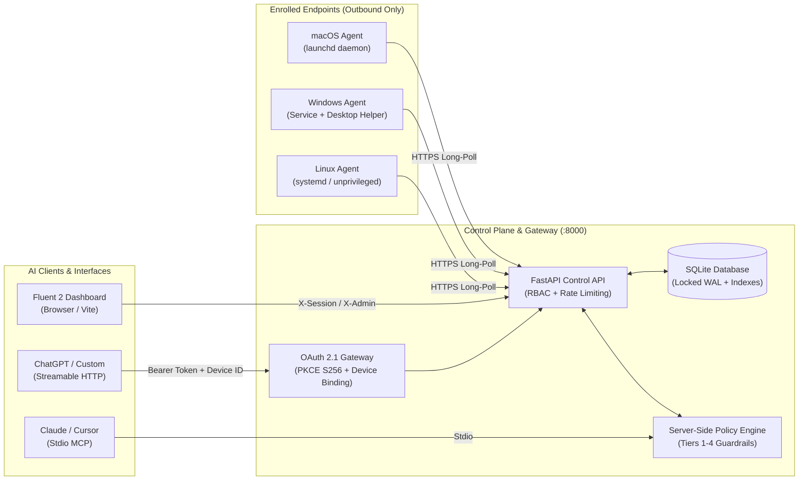

# AI Bridge — Universal AI-to-Computer Control Platform (v0.3.0)

[](https://github.com/ai-bridge/ai-bridge/actions/workflows/ci.yml)
[](https://www.python.org/)
[](LICENSE)
[-green.svg)](docs/security.md)

**AI Bridge** connects authorized AI assistants and coding agents (Claude, Codex, Gemini CLI, other Model Context Protocol clients, and ChatGPT via OAuth 2.1 Streamable HTTP) to Linux, Windows, and macOS computers their owners authorize them to control — through a single, policy-enforced interface.

> [!IMPORTANT]
> **This is not a remote root shell.** There is no unrestricted shell endpoint, no arbitrary PowerShell executor, and no tool that can escalate its own permissions. All actions are subject to server-side policy enforcement, risk tier gating, path confinement, and append-only audit logging.

---

## Architecture & Security Highlights



### Defense-in-Depth Model

1. **Host Tool Protection by Default (`AI_BRIDGE_DISABLE_HOST_TOOLS=1`)**:
   - Host filesystem and shell execution tools on the MCP server are disabled by default. Operations are explicitly routed to enrolled agents via authenticated device bindings.
2. **Device-Bound OAuth 2.1 Gateway**:
   - ChatGPT and remote HTTP clients authenticate through a standards-compliant OAuth 2.1 gateway requiring **PKCE S256**.
   - Tokens are cryptographically bound to specific enrolled `device_id`s, preventing cross-device credential escape.
3. **Four-Tier Policy Guardrails**:
   - **Tier 1 (Read-only)**: Fleet telemetry, system resource inspection, workspace search.
   - **Tier 2 (Low-risk write)**: Workspace file authoring, test execution within defined bounds.
   - **Tier 3 (Sensitive)**: Service management, package installation, backups, desktop vision/actions (requires explicit policy opt-in or human approval).
   - **Tier 4 (High-risk)**: Destructive file deletion, arbitrary shell commands, deployment promotion (strictly requires an authorized human approval record).
4. **Subprocess Environment Isolation**:
   - Invocations of `run_shell` scrub sensitive environment variables (`AI_BRIDGE_ADMIN_TOKEN`, `AI_BRIDGE_DEVICE_TOKEN`, `AI_BRIDGE_OIDC_CLIENT_SECRET`) from child processes, enforce execution timeouts (default 300s), and block symlink escapes.
5. **Recursive Redaction & Audit Integrity**:
   - Secrets matching API keys, bearer tokens, SSH private keys (`id_rsa`, `id_ecdsa`), `.env` files, `.npmrc`, and credentials are recursively scrubbed from all JSON logs and stream payloads before persistence.
6. **Robust Bootstrap & Authentication**:
   - First-time user creation requires an administrative token (`AI_BRIDGE_ADMIN_TOKEN`), preventing unauthorized takeover. Local bootstrap without credentials requires explicit opt-in (`AI_BRIDGE_ALLOW_BOOTSTRAP=1`).

---

## Features

- **Model Context Protocol (MCP)**: Full support for both local stdio and Streamable HTTP transports with bearer authorization.
- **Outbound-Only Poller Agents**: Cross-platform agents (Linux `systemd`, Windows scheduled tasks/desktop helper, macOS `launchd`) that never open inbound listening ports.
- **Human-in-the-Loop Approvals**: Real-time webhook notifications (Telegram, Slack, generic webhooks) with SSRF validation, allowing operators to review, approve, or deny sensitive tasks.
- **Fluent 2 Web Dashboard**: Modern React 18 + TypeScript + Vite management interface supporting dark/light mode, live task inspection, full vision screenshot lightbox, policy history management, and instant emergency stop.
- **Cryptographically Signed Updates**: Offline Ed25519 signature verification for release manifests (`--check-update`).

---

## Quick Start

### ⚡ 1-Command Universal Magic Install (Fresh Bare Servers & Cloud Droplets)

On a completely fresh server (Ubuntu, Debian, CentOS, RHEL, AlmaLinux, Rocky, Fedora, Arch, Alpine, openSUSE):

```bash
curl -sSL https://raw.githubusercontent.com/jacxishipping/ai-bridge/main/magic-install.sh | sudo bash
```

> **Automated Magic Capabilities:**
> - Detects Linux distribution & hardware architecture (x86_64, aarch64/ARM64).
> - Checks and installs all missing system packages, build toolchains (`gcc`, `make`), and Python 3.10+.
> - Auto-provisions a swapfile if the cloud instance has low RAM (<1GB) so package compilation never crashes from OOM.
> - Clones or updates AI Bridge in `/opt/ai-bridge` and provisions an isolated virtual environment (`.venv`).
> - Installs Xvfb & headless GUI automation packages for visual verification and screen capture.
> - Enrolls the agent with your Control Plane (`https://jxiptvplayer.app`).
> - Configures, hardens, and starts the systemd service (`ai-bridge-agent.service`) to auto-restart on boot.

**Unattended / Automated Cloud-Init Deployment:**
```bash
curl -sSL https://raw.githubusercontent.com/jacxishipping/ai-bridge/main/magic-install.sh | sudo bash -s -- -y --control-url "https://jxiptvplayer.app" --admin-token "YOUR_ADMIN_TOKEN"
```

**For Fresh Windows Servers or Desktops (PowerShell as Administrator):**
```powershell
irm https://raw.githubusercontent.com/jacxishipping/ai-bridge/main/magic-install.ps1 | iex
```

---

### 1. Local MCP Server (Stdio)

Run AI Bridge locally for Claude Desktop, Cursor, or Gemini CLI:

```bash
# Clone and prepare virtual environment
git clone https://github.com/ai-bridge/ai-bridge.git
cd ai-bridge
python -m venv .venv

# On Linux / macOS:
source .venv/bin/activate
# On Windows (PowerShell):
# .\.venv\Scripts\Activate.ps1

pip install -e ".[dev]"

# Set workspace confinement directory
mkdir -p "$HOME/ai-bridge-workspace"
export AI_BRIDGE_WORKSPACE="$HOME/ai-bridge-workspace"

# Launch MCP server in stdio mode
python -m ai_bridge.server
```

Configure your MCP client by pointing to the python virtual environment executable and `ai_bridge.server` module. Configuration templates for Claude, Codex, Gemini, and generic MCP clients are located in [`integrations/`](integrations/).

---

### 2. Control Plane & Web Dashboard

To run the remote orchestration server and web management interface:

```bash
# 1. Generate an administrative token and launch the control plane
export AI_BRIDGE_ADMIN_TOKEN="$(python -c "import secrets; print(secrets.token_urlsafe(32))")"
echo "Admin Token: $AI_BRIDGE_ADMIN_TOKEN"

# Start the control plane API (:8000)
python -m ai_bridge.control

# 2. In a separate terminal, launch the dashboard (:5173)
cd apps/dashboard
npm install
npm run dev
```

Open `http://localhost:5173` in your browser and sign in using your `AI_BRIDGE_ADMIN_TOKEN` or configured local credentials.

---

### 3. Enrolling and Running Agents

From the **Enrolled Devices** view in the dashboard (or via `POST /api/devices/enroll`), generate a one-time enrollment token.

#### Linux Agent
```bash
# Run one poll cycle or run persistent loop:
python agents/linux/agent_main.py \
    --control-url http://127.0.0.1:8000 \
    --device-token <ENROLLMENT_TOKEN>
```
For persistent system installations, see [`deployment/systemd/ai-bridge-agent.service`](deployment/systemd/ai-bridge-agent.service).

#### Windows Agent
```powershell
python agents\windows\agent_main.py `
    --control-url http://127.0.0.1:8000 `
    --device-token <ENROLLMENT_TOKEN>
```
For unattended setup as a scheduled task and desktop screenshot helper, see [`deployment/windows/install-agent.ps1`](deployment/windows/install-agent.ps1) and [`agents/windows/desktop_helper.py`](agents/windows/desktop_helper.py).

#### macOS Agent
```bash
python agents/macos/agent_main.py \
    --control-url http://127.0.0.1:8000 \
    --device-token <ENROLLMENT_TOKEN>
```

---

## Configuration Reference

Key environment variables supported across the platform:

| Variable | Default | Purpose |
| :--- | :--- | :--- |
| `AI_BRIDGE_WORKSPACE` | `.` | Directory to which all workspace filesystem operations are confined. Path expansions (`$HOME`, `%USERPROFILE%`) are resolved. |
| `AI_BRIDGE_DATA_DIR` | `~/.ai-bridge` | Base directory for runtime state, databases, and device tokens. |
| `AI_BRIDGE_DISABLE_HOST_TOOLS` | `1` | Disables host-level filesystem and shell tools on the MCP server, enforcing remote agent routing. |
| `AI_BRIDGE_ADMIN_TOKEN` | *(None)* | Secret token for administrative API endpoints and dashboard access. |
| `AI_BRIDGE_ALLOW_BOOTSTRAP` | *(Unset)* | When set to `1`, allows creating the first user without an admin token (for initial zero-configuration setups). |
| `AI_BRIDGE_CONTROL_URL` | `http://127.0.0.1:8000` | Target control plane URL for agent pollers. |
| `AI_BRIDGE_DEVICE_TOKEN` | *(None)* | Authentication bearer token used by polling agents to claim tasks. |
| `AI_BRIDGE_OAUTH_DB` | `/etc/ai-bridge-oauth/oauth.db` | SQLite database path for the OAuth 2.1 gateway. |

---

## Verification & Testing

AI Bridge includes a comprehensive test suite across unit, integration, and security regression domains:

```bash
# Run strict linter checks
ruff check .

# Execute full test suite (75 tests)
pytest -v

# Build frontend dashboard production bundle
npm --prefix apps/dashboard run build
```

---

## Repository Layout

```
ai-bridge/
├── src/ai_bridge/          # Core Python package
│   ├── control/            # FastAPI control plane, DB layer, OIDC, and dispatch
│   ├── diagnostics.py      # System telemetry, process inspection, service status
│   ├── execution.py        # Background task runner, test validators
│   ├── policy.py           # 4-tier risk decision engine
│   ├── security.py         # Path confinement, token redaction, structure sanitizers
│   ├── server.py           # Model Context Protocol (MCP) stdio & HTTP server
│   └── tools.py            # Tool implementations, policy enforcement, shell guardrails
├── agents/                 # Platform poller agents
│   ├── common/             # Resilient HTTP poller with atomic token rotation
│   ├── linux/              # Linux agent entrypoint and CLI
│   ├── macos/              # macOS agent entrypoint and CLI
│   └── windows/            # Windows agent and desktop automation helper
├── apps/
│   ├── control-api/        # Production Uvicorn entrypoint for control plane
│   └── dashboard/          # Fluent 2 React + TypeScript web dashboard
├── deployment/             # Deployment configurations
│   ├── oauth/              # OAuth 2.1 gateway with PKCE S256
│   ├── systemd/            # Linux systemd service units
│   ├── linux/              # Bash installation and run scripts
│   └── windows/            # PowerShell installation scripts
├── integrations/           # Client configuration profiles (Claude, ChatGPT, Codex, Gemini)
├── docs/                   # Architectural guides, threat model, API reference
└── tests/                  # Test suites (unit, integration, security hardening, e2e)
```

---

## License

This project is licensed under the MIT License. See [LICENSE](LICENSE) for details.
