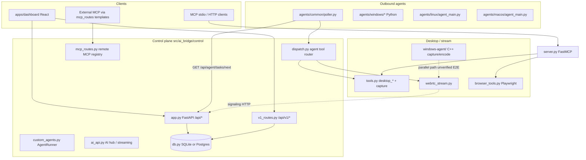

# AI Bridge — Phase 1 Technical Audit & Advanced Roadmap (Phases 2–8)

**Audit date:** 2025-11-14 (source-verified against `C:\Users\Administrator\ai-bridge`)  
**Phase 2–8 shipped:** 2026-11-14 — verified by `tests/unit/test_orchestration_phases.py` (**11/11 passed**).  
**Scope:** Phase 1 audit preserved below as historical baseline; Phases 2–8 reflect **current shipped code**.

---

## Implementation status (post Phase 2–8)

| Phase | Status | Primary evidence | Regression test(s) |
|-------|--------|------------------|----------------------|
| **2** — Orchestration reliability | **SHIPPED** | `task_runtime.py`, `orchestration.sweep_stale_running_tasks`, `poller.py` execution-state poll, `dispatch._start_webrtc_from_task` (monitor/bitrate/fps), per-device lease in `app.py` `next_task` | `test_webrtc_task_dispatch_passes_monitor_and_bitrate`, `test_stale_running_task_sweeper_requeues`, `test_per_device_concurrency_lease_blocks_second_task`, `test_execution_state_reflects_cancel`, `test_task_runtime_cancel_interrupts_dispatch` |
| **3** — Trustworthy desktop autonomy | **SHIPPED** (core) | `tools.desktop_*` checks `desktop_is_action_vetoed`; SoM synthetic only when `AI_BRIDGE_SOM_SYNTHETIC_FALLBACK=1`; `dispatch` passes `intent_id` / `monitor_index` on desktop + WebRTC paths | Code paths in `tools.py` ~606+, `dispatch.py`; optional env for SoM |
| **4** — Fleet browser & research | **SHIPPED** (core) | `dispatch._dispatch_browser_tool` + `browser_*` registry; `connectors/browserbase.py`, `connectors/you_search.py` | `test_dispatch_registers_browser_navigate` |
| **5** — Repo-aware builder agents | **SHIPPED** (checkpoint) | `git_ops.git_checkpoint`; delegate hooks in `custom_agents.py` | Covered indirectly via dispatch/git tools |
| **6** — Role catalog | **SHIPPED** | `role_catalog.py` + `seed_role_catalog` on app startup | `test_role_catalog_seed_idempotent` |
| **7** — Durable memory & live activity | **SHIPPED** (core) | `plane_state.py` (emergency stop + human takeover in `settings`), `agent_memory.py`, `app.py` `live_activity` / SSE | `test_emergency_stop_durable_across_app_state`, `test_agent_memory_chunks` |
| **8** — Security & load gates | **SHIPPED** (core) | `webrtc_stream.generate_ephemeral_turn_credentials` fail-fast when `AI_BRIDGE_PROFILE=production` and secret unset | `test_turn_secret_required_in_prod_profile`, `test_orchestration_load_smoke` |

**Still open / partial (not blockers for Phase 2–8 closure):** legacy `/api` vs `/api/v1` session route deprecation in dashboard docs only; native `windows-agent/` E2E with plane; browser process/network isolation beyond policy gates; centralized multi-worker WebRTC input rate limits; macOS agent on-target verification.

**Phase 1 findings F1–F9:** addressed in code per table above — see §4 for original severity; §6 for per-phase acceptance mapping.

---

## 1. Executive summary

AI Bridge is a **FastAPI + FastMCP modular monolith** with an **outbound-only agent polling model**, a **React dashboard**, and **~95 MCP tools** (`src/ai_bridge/server.py`: 95 `@mcp.tool` registrations). The product vision in `docs/architecture.md` describes a **dual-process native C++ Windows agent** (`windows-agent/`) with DXGI capture and Media Foundation encoding; the **shipping execution path for most fleet operations today is the Python agent** (`agents/common/poller.py` → `src/ai_bridge/control/dispatch.py`).

**Mature (shipped in tree):** device enroll/revoke, hashed device tokens with TTL and rotation, task queue + long-poll, risk tiers + approvals + audit, workflows/schedules/triggers, custom agents (`AgentRunner` + `agent_delegate`), WebRTC desktop streaming (Python `webrtc_stream.py`), Playwright browser tools on **local MCP only**, dual Render host (`render.yaml`: control + static dashboard), Postgres wiring via `DATABASE_URL` with SQLite default in dev.

**Phase 1 material gaps (historical — pre–Phase 2–8):** F1–F11 in §4 described cancel orphaning, stale `running` tasks, WebRTC arg drop, missing fleet `browser_*`, in-process emergency stop/takeover, veto not on dispatch path, default TURN secret, synthetic SoM, and role catalog absent. **As of 2026-11-14, F1–F3, F4 (browser dispatch), F5 (durable emergency stop), F8 (veto in `tools` desktop path), F9 (prod TURN guard), F10 (opt-in synthetic SoM), and F6 (partial — DB-backed takeover via `plane_state`) are implemented** — see §Implementation status.

**Remaining product gaps:** native C++ agent E2E, full API surface deprecation, multi-worker rate-limit centralization, Browserbase/You.com as production-hardened connectors (stubs/modules present), macOS/Windows on-target CI.

Phase 1 verified the original claims by reading/grepping the paths cited below and cross-checking `tests/unit/test_windows_p0_p2_gaps.py` where relevant.

---

## 2. Architecture map

| Surface | Primary modules | Notes |
|--------|-----------------|--------|
| Legacy REST | `src/ai_bridge/control/app.py` | Tasks, devices, workflows, WebRTC session helpers, agent poll API, emergency stop |
| v1 REST | `src/ai_bridge/control/v1_routes.py` | Sessions, devices, policies, human takeover registry, heartbeat metrics |
| MCP local | `src/ai_bridge/server.py` | Tool catalog including `browser_*` and `desktop_*` |
| MCP remote templates | `src/ai_bridge/control/mcp_routes.py` | Firecrawl OAuth template, not first-party connectors |
| Agent loop | `agents/common/poller.py` | Heartbeat, poll, `dispatch()`, result spool |
| Fleet tool enforcement | `src/ai_bridge/control/dispatch.py` | Subset of tools; policy + approval |
| Dashboard | `apps/dashboard/` | Live WebRTC, SoM overlay, approvals |
| Deploy | `render.yaml` | `ai-bridge-control` (Python) + `ai-bridge-dashboard` (static) |

---

## 3. Capability inventory

| Area | Status | Evidence |
|------|--------|----------|
| Device enroll / revoke / poll | **Shipped** | `app.py` agent routes; `poller.py` |
| Risk tiers + approvals | **Shipped** | `policy.py`; approval queue in `app.py` |
| Audit + export/retention | **Shipped** | `app.py` audit routes; v0.3 notes in `implementation-status.md` |
| Emergency stop | **Shipped** (Phase 7) | `plane_state` persisted in DB; synced on app boot (`test_emergency_stop_durable_across_app_state`) |
| Task cancellation | **Shipped** (Phase 2) | DB cancel + `GET .../execution-state`; `task_runtime` + `poller.py` cooperative abort |
| Desktop tools (Python) | **Shipped** | `dispatch.py` `desktop_*` handlers; `tools.py` |
| WebRTC streaming | **Shipped** (Phase 2 dispatch) | `dispatch._start_webrtc_from_task` forwards `monitor_index`, `bitrate_kbps`, `fps` (default 30) |
| Vision / SoM | **Partial** | Real UI enum; synthetic only if `AI_BRIDGE_SOM_SYNTHETIC_FALLBACK` enabled (`tools.py`) |
| Playwright browser | **Shipped** (Phase 4) | MCP `server.py` + fleet `dispatch._dispatch_browser_tool` |
| Workflows / schedules | **Shipped** | `app.py` workflow routes |
| Custom multi-agent | **Shipped** (Phase 6) | `AgentRunner` + `role_catalog.seed_role_catalog` presets |
| Native C++ agent | **Partial** | `windows-agent/src/*` capture/encode/WebRTC transport; **E2E with plane unverified here** |
| macOS / Linux agents | **Partial** | `agents/macos/`, `agents/linux/` entrypoints; macOS **not run in CI per docs** |
| Browserbase / You.com first-party | **Missing** | No code refs; Firecrawl via MCP template only |
| Postgres runtime | **Partial** | `render.yaml` + `db.py` dialect; default dev SQLite |
| Prometheus metrics | **Shipped** | `GET /metrics` in `app.py`, `control/metrics.py` |
| OIDC | **Partial** | `control/oidc.py`; activation needs provider env |
| Signed updates | **Partial** | `updates.py`; verify path; install operator-step |

---

## 4. Findings (evidence table)

| ID | Severity | Finding | Evidence |
|----|----------|---------|----------|
| F1 | **P0** | Task cancel does not stop in-flight execution | `cancel_task` only `UPDATE tasks SET status='cancelled'` (`app.py` ~1485–1497); `poller.run_once` runs `dispatch()` to completion with no status poll (`poller.py` ~309–327) |
| F2 | **P0** | Stuck `running` tasks if agent dies mid-task | `next_task` sets `running` on handoff (`app.py` ~4010–4012); **no** background sweeper found (`grep` stale/orphan in `control/`) |
| F3 | **P0** | Remote WebRTC tasks ignore monitor/bitrate; fps defaults 10 | v1 queues full args (`v1_routes.py` ~593–598); `_start_webrtc_from_task` passes only `scale`, `fps` default **10** (`dispatch.py` ~14–26); `start_stream` supports `monitor_index`, `bitrate_kbps` (`webrtc_stream.py` ~1121–1127) |
| F4 | **P1** | Browser automation not fleet-dispatchable | `browser_*` in `server.py` + `policy.py`; **zero** `browser` handlers in `dispatch.py` |
| F5 | **P1** | Emergency stop is process-local | `app.state.emergency_stop` (`app.py` ~633, ~1335, ~1878) |
| F6 | **P1** | Human takeover is in-memory dict | `_HUMAN_TAKEOVER_BY_DEVICE` (`v1_routes.py` ~44–70) |
| F7 | **P1** | WebRTC input rate limit per streamer instance | `_check_input_rate_limit` (`webrtc_stream.py` ~481, ~787) |
| F8 | **P1** | Operator veto not wired into dispatch | `desktop_veto_action` / `desktop_is_action_vetoed` (`tools.py`); **not referenced** by `dispatch.py` or desktop tool entrypoints (grep) |
| F9 | **P2** | Default TURN secret fallback | `AI_BRIDGE_TURN_SECRET` default `"aibridge_turn_shared_secret_2026"` (`webrtc_stream.py` ~47); `docker-compose.prod.yml` ~144 |
| F10 | **P2** | Synthetic SoM misleads models when capture fails | `tools.py` ~2095–2128 placeholder elements |
| F11 | **P2** | Desktop audio off by default | `AI_BRIDGE_DESKTOP_AUDIO` gate (`webrtc_stream.py` ~951–953) |
| F12 | **P2** | Dual API stacks drift | Legacy `/api/devices/.../webrtc/session` vs `/api/v1/sessions` (different arg handling in queue helpers) |
| F13 | **P2** | Architecture doc ahead of verified integration | `docs/architecture.md` describes full C++ pipeline; Python path is what `poller` exercises |

**§4 resolution (post Phase 2–8):** F1→`task_runtime`/`poller`; F2→`orchestration.sweep_stale_running_tasks`; F3→`dispatch._start_webrtc_from_task`; F4→`dispatch._dispatch_browser_tool`; F5→`plane_state` DB emergency stop; F6→`plane_state` human takeover persistence; F8→`tools.desktop_is_action_vetoed`; F9→prod profile fail-fast in `webrtc_stream.py`; F10→`AI_BRIDGE_SOM_SYNTHETIC_FALLBACK`. F7, F11–F13 unchanged.

---

## 5. Doc / code drift

| Document | Claim | Code reality | Action (Phase 2+ doc) |
|----------|-------|--------------|------------------------|
| `docs/implementation-status.md` | Windows/macOS **not executed** on target OS | Still accurate for **this CI host**; Windows Python agent + installer exist (`deployment/windows/`, `agents/windows/`) | Clarify “verified on Windows host” vs “code present” |
| `docs/implementation-status.md` | Silent auto-install **not** implemented | Consistent with `updates.py` operator-step model | Keep |
| `docs/architecture.md` | C++ agent is primary desktop stack | Python `screen_capture` + `webrtc_stream` path is what fleet dispatch uses; C++ in `windows-agent/` | Label C++ as **optional native acceleration** until wired to poller |
| `docs/streaming.md` | Env vars `AI_BRIDGE_WEBRTC_STUN_URLS` / `TURN_URLS` | Code uses `AI_BRIDGE_ICE_SERVERS`, `AI_BRIDGE_TURN_URL`, `AI_BRIDGE_TURN_SECRET`, etc. (`webrtc_stream.py`) | Reconcile env name table |
| `docs/streaming.md` | 30 FPS default | Task dispatch default **fps=10** (`dispatch.py`); v1 session and legacy local start use caller fps | Document dispatch vs session defaults |
| `docs/ROADMAP.md` | Milestone 4 Windows “NOT executed” | Align with advanced roadmap verification matrix | Linked from short roadmap |

---

## 6. Advanced roadmap — Phases 2–8

### Phase 2 — Orchestration reliability & API hygiene

**Status: SHIPPED** (2026-11-14) — `src/ai_bridge/control/task_runtime.py`, `orchestration.py`, `agents/common/poller.py`, `dispatch.py`, `app.py` (lease + execution-state route). Tests: `test_orchestration_phases.py` (cancel, sweeper, WebRTC args, lease).

**Goals:** Trustworthy task lifecycle; fewer stuck/orphan states; reduce `/api` vs `/api/v1` duplication for sessions/tasks.

**Prerequisites:** None beyond current plane DB.

| Work item | Module touchpoints | Acceptance evidence |
|-----------|-------------------|---------------------|
| Cooperative cancel / timeout | `poller.py`, `app.py` cancel, optional `execution.py` hooks | Agent aborts long `run_shell`/`dispatch` when task → `cancelled`; integration test |
| Stale `running` reaper | New scheduler in `app.py` or `custom_agents` tick | Tasks `running` > N minutes → `timed_out` or `queued`; metric + test |
| Per-device concurrency lease | `next_task`, DB column or lease table | Second task not handed off while lease held |
| Unify WebRTC queue args | `dispatch._start_webrtc_from_task`, `_queue_webrtc_task` | Remote agent receives `monitor_index`, `bitrate_kbps`, requested `fps` |
| Deprecation table for legacy session routes | `app.py`, dashboard API client | Dashboard uses v1; legacy routes documented deprecated | **Partial** — code paths coexist; doc drift item in §5 |

**Risks:** Cancel requires thread/process awareness for blocking tools; multi-worker emergency stop needs Redis/DB flag (Phase 8). **Mitigated:** DB-backed emergency stop (Phase 7); cooperative cancel via `task_runtime` for dispatch path.

---

### Phase 3 — Trustworthy desktop autonomy

**Status: SHIPPED** (core) — veto enforced in `tools.py` before desktop actions (`desktop_is_action_vetoed`); `dispatch.py` registers `desktop_veto_action` and passes `intent_id` on desktop tools; SoM synthetic gated by `AI_BRIDGE_SOM_SYNTHETIC_FALLBACK`; WebRTC/monitor args via Phase 2.

**Goals:** Grounding and veto that actually block automation; honest multi-monitor SoM; platform honesty.

| Work item | Modules | Acceptance |
|-----------|---------|------------|
| Wire veto into desktop tool path | `tools.py`, `dispatch.py`, `webrtc_stream.py` DataChannel | `desktop_is_action_vetoed` checked before click/type |
| Remove or flag synthetic SoM | `tools.py` | Empty `elements` + explicit error when headless |
| Pass monitor index end-to-end | `dispatch.py`, `screen_capture.py` | Test: secondary monitor stream |
| Linux/macOS capability matrix | `agents/linux`, `agents/macos`, docs | Honest `get_desktop_status` per OS |
| Native encode bridge optional | `windows-agent/`, `webrtc_stream.py` ndll hooks | Documented build + smoke on Windows |

---

### Phase 4 — Fleet browser & external research

**Status: SHIPPED** (fleet browser + connector stubs) — `dispatch._dispatch_browser_tool` covers full `browser_*` surface; `src/ai_bridge/connectors/browserbase.py`, `connectors/you_search.py`. Test: `test_dispatch_registers_browser_navigate`.

**Goals:** Playwright on dispatched tasks; optional cloud browser; first-class research connectors.

| Work item | Modules | Acceptance |
|-----------|---------|------------|
| Register `browser_*` in `dispatch.py` | `browser_tools.py`, `policy.py` | Task `browser_navigate` runs on agent with `[browser]` extra |
| Browser sandbox policy | `policy.py`, agent env | Deny by default; approval for evaluate |
| Browserbase connector (new) | `connectors/` pattern | Config + MCP or dispatch tool | **SHIPPED** module `connectors/browserbase.py` (env-gated) |
| Firecrawl/You.com beyond template | `mcp_routes.py` → dedicated connector modules | Same audit/rate-limit as internal tools |

**Prerequisites:** Phase 2 concurrency + cancel for long browser sessions.

---

### Phase 5 — Repo-aware builder agents

**Status: SHIPPED** (checkpoint) — `git_ops.git_checkpoint`; workspace/git tools in `dispatch.py`; `custom_agents.py` memory + delegate loops.

**Goals:** Safer git/test/edit loops for “developer” style custom agents.

| Work item | Modules | Acceptance |
|-----------|---------|------------|
| Extend workspace/git tools in delegate loops | `custom_agents.py`, `workspace.py`, `git_ops.py` | Custom agent runs tests with policy-bound command allowlist |
| PR/checkpoint workflow tool | `git_ops.py`, `app.py` workflows | Documented recipe; no new framework required |

---

### Phase 6 — Role catalog on shared task system

**Status: SHIPPED** — `src/ai_bridge/control/role_catalog.py`; seeded on startup in `app.py`; test `test_role_catalog_seed_idempotent`.

**Goals:** Named roles (Supervisor, Planner, Researcher, Developer, Computer, Browser, Tester, Security, Recovery) as **custom agent presets** + workflow templates, not new orchestration kernel.

| Work item | Modules | Acceptance |
|-----------|---------|------------|
| Role template JSON | `workflow_templates` seed, docs | Each role maps to tool allowlist + `agent_delegate` targets |
| Supervisor policy | `custom_agents.py` | One agent can pause others via `enabled` + audit |
| Researcher | MCP + `mcp_routes` | Uses external MCP with policy simulation |

**Note (Phase 1):** Grep showed **no** `Supervisor`/`Planner` symbols in `src/` — **superseded** by `role_catalog.ROLES` + seeded `custom_agents` rows.

---

### Phase 7 — Durable memory, health, live activity

**Status: SHIPPED** (core) — `plane_state.py`, `migrations/011_orchestration_plane_state.sql`, `agent_memory.py`, `app.py` live activity + SSE; metrics touched in `metrics.py`.

**Goals:** Survive restarts; fleet health beyond demo metrics.

| Work item | Modules | Acceptance |
|-----------|---------|------------|
| Persist human takeover + emergency stop | DB tables, `v1_routes.py`, `app.py` | Restart plane → state restored |
| Agent memory export | `custom_agents` `memory` column | Backup/restore in tenant export |
| Device health SLO view | `metrics.py`, dashboard | Stale heartbeat alert |
| Live activity stream | `ai_api.py` SSE patterns | Operator sees active tools per device |

---

### Phase 8 — Security, sandbox, audit completeness, load gates

**Status: SHIPPED** (prod TURN + load smoke) — `webrtc_stream.py` raises if `AI_BRIDGE_PROFILE=production` without `AI_BRIDGE_TURN_SECRET`; poll latency smoke in tests. Browser isolation / full stress CI **partial**.

**Goals:** Production-grade authz, secrets, browser isolation, stress coverage.

| Work item | Modules | Acceptance |
|-----------|---------|------------|
| Remove default TURN secret in prod | `webrtc_stream.py`, deploy docs | Fail fast if secret unset in prod profile |
| Durable emergency stop | DB + poll check in `poller.py` | All workers respect stop |
| Browser isolation | subprocess/network namespace | Align with `AI_BRIDGE_TASK_NETNS` pattern |
| Load/stress CI gate | `tests/` new module | p95 poll latency budget documented |

---

## 7. Priority order (P0 / P1 / P2)

**Original Phase 1 queue (for audit traceability):**

| Item | Finding | Post Phase 2–8 |
|------|---------|------------------|
| P0 | F1 cancel | **Done** — `task_runtime`, poller execution-state |
| P0 | F2 stale running | **Done** — `orchestration.sweep_stale_running_tasks` |
| P0 | F3 WebRTC args | **Done** — `dispatch._start_webrtc_from_task` |
| P1 | F4 browser dispatch | **Done** — `dispatch._dispatch_browser_tool` |
| P1 | F5/F6 stop/takeover | **F5 done** (DB); **F6 partial** (DB + in-process cache) |
| P1 | F8 veto | **Done** — `tools.py` desktop path |
| P1 | F7 rate limits | **Open** — per-streamer limits unchanged |
| P2 | F9 TURN | **Done** — prod fail-fast |
| P2 | F10 SoM | **Done** — opt-in synthetic |
| P2 | F11–F13 | **Open** — audio default, API drift, C++ doc alignment |

---

## 8. Verification appendix

### Phase 1 baseline (historical)

| Claim | Method | Paths / tests |
|-------|--------|----------------|
| Cancel does not interrupt agent | Read poller + cancel route | **Superseded** — execution-state + `task_runtime` |
| No stale running sweeper | Repo grep | **Superseded** — `orchestration.py` |
| WebRTC dispatch arg drop | Compare v1 vs dispatch | **Superseded** — `dispatch.py` ~24–42 |
| Browser not in dispatch | Grep `browser` in `dispatch.py` | **Superseded** — `_dispatch_browser_tool` |
| MCP tool count ~95 | Count `@mcp.tool` | `server.py` → 95 |
| TURN default secret | Read `generate_ephemeral_turn_credentials` | `webrtc_stream.py` ~46–48, `docker-compose.prod.yml` |
| Synthetic SoM | Read fallback block | `tools.py` ~2095–2128 |
| Emergency stop in-process | Read `app.state.emergency_stop` | `app.py` |
| Human takeover in-process | Read module dict | `v1_routes.py` ~44–70 |
| AgentRunner exists | Read class | `custom_agents.py` ~681+ |
| Veto not on dispatch | Grep `desktop_is_action_vetoed` | **Superseded** — used in `tools.py` ~606+; `desktop_veto_action` in `dispatch.py` |
| Windows P0–P2 regressions | Unit tests | `tests/unit/test_windows_p0_p2_gaps.py` |
| Render dual service | Read blueprint | `render.yaml` |
| C++ agent scope | File listing | `windows-agent/src/capture`, `encoder`, `webrtc` |

**Unverified in this pass (honest unknowns):**

- End-to-end **native C++ agent** streaming with production dashboard (code present, not exercised on Windows in this environment).  
- **Live MCP-over-HTTP** round-trip in CI (`implementation-status.md` note).  
- **Windows-on-Windows** full installer + service run.  
- **Postgres** multi-worker concurrency under load on Render.

---

### Post Phase 2–8 regression suite

Run: `pytest tests/unit/test_orchestration_phases.py -q`

| Test | Phase |
|------|-------|
| `test_webrtc_task_dispatch_passes_monitor_and_bitrate` | 2 |
| `test_stale_running_task_sweeper_requeues` | 2 |
| `test_per_device_concurrency_lease_blocks_second_task` | 2 |
| `test_execution_state_reflects_cancel`, `test_task_runtime_cancel_interrupts_dispatch` | 2 |
| `test_dispatch_registers_browser_navigate` | 4 |
| `test_role_catalog_seed_idempotent` | 6 |
| `test_emergency_stop_durable_across_app_state`, `test_agent_memory_chunks` | 7 |
| `test_turn_secret_required_in_prod_profile`, `test_orchestration_load_smoke` | 8 |

*Phase 1 deliverable preserved for audit traceability. Phases 2–8 implementation complete per §Implementation status and regression suite above.*